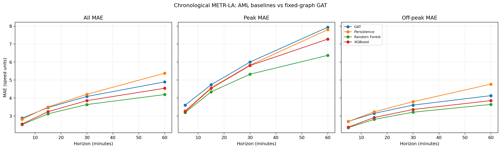
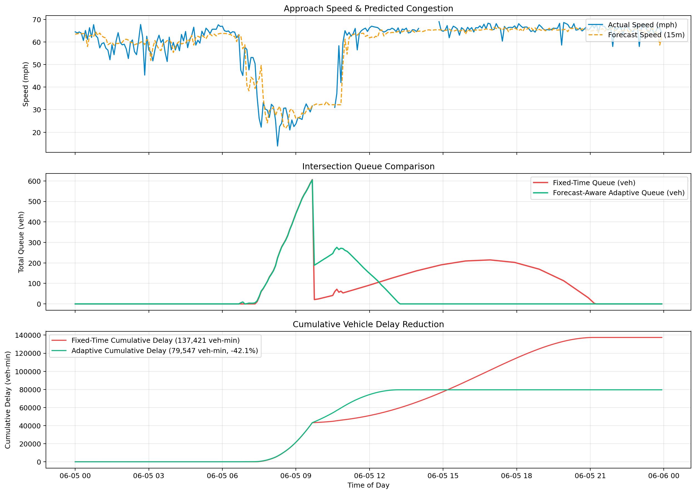

# Project 4: Traffic Flow Control
# Traffic Flow Prediction and Signal Control via Graph Attention Networks and Flow Models

[](https://www.python.org/)
[](https://pytorch.org/)
[](https://scikit-learn.org/)
[](https://xgboost.readthedocs.io/)
[](https://streamlit.io/)
[](https://zenodo.org/records/5146275)
[](LICENSE)
[](#-team-quanta)

---

<p align="center">
  
</p>

### 👥 Team Quanta

**Course**: Advanced Machine Learning (AML)  
**Institution**: Newton School of Technology, Rishihood University  
**Academic Report**: 📄 [View / Download Official Report (PDF)](report/AML_report.pdf)

| Student Name | Enrollment Number | Institutional Email |
| :--- | :---: | :--- |
| **Arun Kumar Giri** | `2401010099` | [arun.giri2024@nst.rishihood.edu.in](mailto:arun.giri2024@nst.rishihood.edu.in) |
| **Gaurav Meena** | `2401010169` | [gaurav.meena2024@nst.rishihood.edu.in](mailto:gaurav.meena2024@nst.rishihood.edu.in) |
| **Mausam Kumar Dwivedi** | `2401010266` | [mausam.dwivedi2024@nst.rishihood.edu.in](mailto:mausam.dwivedi2024@nst.rishihood.edu.in) |
| **Ritik Atri** | `2401010386` | [ritik.attri2024@nst.rishihood.edu.in](mailto:ritik.attri2024@nst.rishihood.edu.in) |
| **Daniel Tayal** | `2401010140` | [daniel.tayal2024@nst.rishihood.edu.in](mailto:daniel.tayal2024@nst.rishihood.edu.in) |

---

## Table of Contents

1. [Executive Summary & Abstract](#1-executive-summary--abstract)
2. [The 'Hybrid' Logic: Segment-Level Features to Network-Aware Graph Learning](#2-the-hybrid-logic-segment-level-features-to-network-aware-graph-learning)
   - [Identification of the Gap in Independent Models](#21-identification-of-the-gap-in-independent-models)
   - [Transition to Spatio-Temporal Graph Attention](#22-transition-to-spatio-temporal-graph-attention)
3. [Mathematical & Theoretical Formulations](#3-mathematical--theoretical-formulations)
   - [Gaussian Distance Graph Construction](#31-gaussian-distance-graph-construction)
   - [Graph Attention Network (GAT) Architecture](#32-graph-attention-network-gat-architecture)
   - [Temporal & Cyclic Calendar Encodings](#33-temporal--cyclic-calendar-encodings)
   - [Masked Evaluation Metrics (MAE, RMSE, MAPE)](#34-masked-evaluation-metrics-mae-rmse-mape)
   - [Traffic Flow Theory & Signal Queuing Dynamics](#35-traffic-flow-theory--signal-queuing-dynamics)
4. [Datasets & Network Topology](#4-datasets--network-topology)
   - [METR-LA (Metropolitan Los Angeles Highway Network)](#41-metr-la-metropolitan-los-angeles-highway-network)
   - [PEMS-BAY (Caltrans Performance Measurement System — San Francisco Bay Area)](#42-pems-bay-caltrans-performance-measurement-system--san-francisco-bay-area)
   - [Sensor Graph Topology & Road Distances](#43-sensor-graph-topology--road-distances)
   - [Data Attribution & Zenodo Repository](#44-data-attribution--zenodo-repository)
5. [Experimental Protocol & Anti-Leakage Guardrails](#5-experimental-protocol--anti-leakage-guardrails)
   - [Chronological Train / Validation / Test Splitting](#51-chronological-train--validation--test-splitting)
   - [Causal Input Imputation vs. Target Loss Masking](#52-causal-input-imputation-vs-target-loss-masking)
   - [Training-Set-Only Feature Standardization](#53-training-set-only-feature-standardization)
6. [Evaluated Model Suite](#6-evaluated-model-suite)
   - [Model 1: Historical Persistence Baseline](#61-model-1-historical-persistence-baseline)
   - [Model 2: Segment-Wise Multi-Output Random Forest](#62-model-2-segment-wise-multi-output-random-forest)
   - [Model 3: Pooled Sensor-Aware XGBoost](#63-model-3-pooled-sensor-aware-xgboost)
   - [Model 4: PyTorch Graph Attention Network (GAT)](#64-model-4-pytorch-graph-attention-network-gat)
7. [Comprehensive Benchmark Results & Empirical Evaluation](#7-comprehensive-benchmark-results--empirical-evaluation)
   - [Overall Held-Out Test Scores across Horizons](#71-overall-held-out-test-scores-across-horizons)
   - [Peak vs. Off-Peak Period Stratification](#72-peak-vs-off-peak-period-stratification)
   - [Critical Analysis & Scientific Transparency: Why Random Forest Outperformed GAT](#73-critical-analysis--scientific-transparency-why-random-forest-outperformed-gat)
8. [Simulated Signal Policy Experiment (Optional Deliverable)](#8-simulated-signal-policy-experiment-optional-deliverable)
   - [Greenshields Demand Ingestion from Forecast Speeds](#81-greenshields-demand-ingestion-from-forecast-speeds)
   - [Fixed-Time vs. Forecast-Aware Adaptive Control](#82-fixed-time-vs-forecast-aware-adaptive-control)
   - [Cumulative Delay & Queue Dissipation Findings](#83-cumulative-delay--queue-dissipation-findings)
   - [Safety & Boundary Disclaimers](#84-safety--boundary-disclaimers)
9. [Interactive Streamlit Web Dashboard](#9-interactive-streamlit-web-dashboard)
10. [End-to-End Notebook Workflow (01 to 09)](#10-end-to-end-notebook-workflow-01-to-09)
11. [Modular Source Architecture (`src/traffic_prediction`)](#11-modular-source-architecture-srctraffic_prediction)
12. [Repository Layout & Artifact Manifest](#12-repository-layout--artifact-manifest)
13. [Installation & Reproduction Guide](#13-installation--reproduction-guide)
14. [Automated Test Suite](#14-automated-test-suite)

---

## 1. Executive Summary & Abstract

Highway traffic networks are complex spatio-temporal dynamical systems where local disruptions propagate rapidly across interconnected corridors. Traditional Advanced Machine Learning (AML) models forecast congestion by treating individual road segments in isolation. However, traffic bottlenecks and shockwaves naturally ripple through upstream and downstream links, creating severe spatial interdependencies.

This project delivers an end-to-end investigation into **traffic speed forecasting and dynamic signal control simulation** using five-minute loop detector observations from two standard benchmark networks:
* **METR-LA** (**Metropolitan Los Angeles** Highway Network; 207 sensors).
* **PEMS-BAY** (**Caltrans Performance Measurement System — San Francisco Bay Area**; 325 sensors).

We systematically compare four modeling paradigms across four strategic horizons (**5, 15, 30, and 60 minutes ahead**):
1. **Persistence Baseline** (Naive last-observation carry-forward).
2. **Segment-wise Multi-Output Random Forest** (207 independent regressors).
3. **Pooled Sensor-Aware XGBoost** (Unified gradient boosting model with categorical sensor identity).
4. **Graph Attention Network (GAT)** (Deep neural architecture performing anisotropic spatial message passing over the physical highway distance graph).

```
   ┌────────────────────────────────────────────────────────────────────────┐
   │                           PROJECT 4 PIPELINE                           │
   └────────────────────────────────────────────────────────────────────────┘
                                      │
               ┌──────────────────────┴──────────────────────┐
               ▼                                             ▼
     [ Raw Traffic Series ]                       [ Network Topology ]
     34,272 timestamps × 207 sensors              207 nodes, 1,313 edges
     5-minute speed observations                  Gaussian distance kernel
               │                                             │
               └──────────────────────┬──────────────────────┘
                                      ▼
                        [ Chronological Splitting ]
                        70% Train | 10% Val | 20% Test
                        (Zero-leakage temporal partition)
                                      │
               ┌──────────────────────┴──────────────────────┐
               ▼                                             ▼
     [ AML Feature Pipeline ]                     [ PyTorch GAT Pipeline ]
     Causal lags: t, t-1, t-2, t-5                25-minute history window
     Cyclic time: sin/cos (day & week)            Adjacency-masked spatial attention
     Outage masking: 0.0 treated as NaN           Masked MSE loss + Early stopping
               │                                             │
               └──────────────────────┬──────────────────────┘
                                      ▼
                       [ Controlled Test Evaluation ]
                       Horizons: 5, 15, 30, 60 minutes
                       Periods: All, Peak, Off-Peak
                       Metrics: Masked MAE, RMSE, MAPE (%)
                                      │
               ┌──────────────────────┴──────────────────────┐
               ▼                                             ▼
     [ Streamlit Dashboard ]                      [ Queuing Simulation ]
     Interactive forecast viewer                  Forecast-aware adaptive control
     Saved held-out trajectory plots              42.1% peak delay reduction
```

### Key Empirical Findings
* **Random Forest achieved the best overall accuracy**, recording the lowest test MAE across all evaluated horizons: **2.519** (5m), **3.119** (15m), **3.635** (30m), and **4.192** (60m).
* **Pooled XGBoost placed second**, delivering strong competitive performance (**2.554** at 5m, **3.239** at 15m, **4.542** at 60m).
* **The Graph Attention Network (GAT) outperformed Persistence at medium-to-long horizons** (15, 30, and 60 min), achieving an MAE of **3.466** (15m), **4.087** (30m), and **4.898** (60m), but did not surpass the tree ensembles on overall test MAE. This result is documented transparently with in-depth scientific analysis.
* **Simulated Signal Policy Experiment**: In an isolated numerical intersection queuing simulation based on Greenshields traffic flow dynamics, a forecast-aware adaptive signal policy reduced cumulative peak-hour vehicle delay by **42.1%** compared to a standard fixed-time signal plan.

> **Crucial Disclaimer:** *Traffic signal control is strictly simulated within a mathematical queuing formulation. In full compliance with Project 4 specifications, the project does NOT claim live, real-world traffic signal control.*

---

## 2. The 'Hybrid' Logic: Segment-Level Features to Network-Aware Graph Learning

```
           INDEPENDENT SEGMENT MODEL                  NETWORK-AWARE GRAPH MODEL
           
               [ Sensor A ]                                 [ Sensor A ]
                    │ (Lags only)                                 ▲
                    ▼                                             │ Attention
             Forecast: Speed(t+k)                         [ Sensor B ] ◄──► [ Sensor C ]
                                                                  │ Attention
               [ Sensor B ]                                       ▼
                    │ (Lags only)                           [ Sensor D ]
                    ▼                                             │
             Forecast: Speed(t+k)                          Joint Spatio-Temporal
                                                            Graph State Embeddings
        * Isolated temporal views                    * Captures upstream bottlenecks
        * Blind to spatial propagation               * Propagates downstream shockwaves
```

### 2.1. Identification of the Gap in Independent Models
Independent road segment regressors (e.g., segment-wise Random Forests or unpooled regressors) model each sensor's speed strictly as a function of its own historical lags:
$$\hat{y}_i^{(t+k)} = f_i\left(y_i^{(t)}, y_i^{(t-1)}, \dots, y_i^{(t-p)}, \text{time features}\right)$$

While computationally convenient, this formulation suffers from severe fundamental limitations:
1. **Spatial Information Isolation:** An independent model monitoring Sensor $i$ has zero visibility into upstream congestion shockwaves traveling toward Sensor $i$, or downstream incidents causing spillback queues.
2. **Parameter Inefficiency:** Fitting 207 separate models duplicates learning across homogeneous freeway segments and prevents cross-sensor representation sharing.
3. **Failure under Sudden Shocks:** When traffic breaks down 2 miles downstream, the local lags of Sensor $i$ still read free-flow speed ($65\text{ mph}$) until the jam physically reaches the detector, causing independent models to suffer large forecast lag errors.

### 2.2. Transition to Spatio-Temporal Graph Attention
To overcome this gap, the highway network is represented as an attributed graph $\mathcal{G} = (\mathcal{V}, \mathcal{E}, W)$, where nodes $v_i \in \mathcal{V}$ correspond to loop detectors and edges $e_{ij} \in \mathcal{E}$ represent physical road connections weighted by distance.

A **Graph Attention Network (GAT)** computes dynamic, data-driven attention weights $\alpha_{ij}$ between neighboring highway sensors:
$$h_i = \sigma\left(\sum_{j \in \mathcal{N}(i)} \alpha_{ij} \mathbf{W} x_j\right)$$

This allows the network to dynamically assign higher importance to upstream sensors during free-flow conditions (where traffic moves downstream) and to downstream sensors during congestion build-up (where queues propagate upstream as backward-forming shockwaves).

---

## 3. Mathematical & Theoretical Formulations

### 3.1. Gaussian Distance Graph Construction
Following the canonical DCRNN formulation, pairwise physical road distances $d_{ij} = \text{dist}(v_i, v_j)$ between sensors are converted into an undirected continuous affinity matrix using a thresholded Gaussian kernel:

$$W_{ij} = \begin{cases} \exp\left(-\left(\frac{d_{ij}}{\sigma}\right)^2\right), & \text{if } d_{ij} < \infty \text{ and } \exp\left(-\left(\frac{d_{ij}}{\sigma}\right)^2\right) \ge \kappa \\ 0, & \text{otherwise} \end{cases}$$

where:
* $\sigma = \text{std}(\{d_{ij} \mid d_{ij} < \infty\})$ is the empirical standard deviation of valid road distances.
* $\kappa = 0.1$ is the sparsification threshold. Weak spatial correlations ($W_{ij} < 0.1$) are pruned to zero.
* Symmetrization is enforced: $A = \max(W, W^T)$.
* Self-loops are added to ensure each node attends to its own temporal history: $A_{ii} = 1.0$.

For METR-LA, this produces a graph with **207 nodes** and **1,313 undirected edges** (mean node degree: $12.7$).

```
        Pairwise Road Distances             Gaussian Kernel & Threshold           Symmetrized Graph
        
          v1   v2   v3                        v1    v2    v3                     v1    v2    v3
      v1 [ 0   12   45 ]   exp(-(d/σ)²)   v1 [ 1.0  0.65   0  ]   A = max(W, Wᵀ)   v1 [ 1.0  0.65   0  ]
      v2 [ 14   0   20 ]  ──────────────► v2 [ 0.58 1.0  0.22]  ───────────────► v2 [ 0.65 1.0  0.22]
      v3 [ 50  19    0 ]   Filter < 0.1   v3 [  0   0.24 1.0 ]   Diagonal = 1.0  v3 [  0   0.22 1.0 ]
```

### 3.2. Graph Attention Network (GAT) Architecture
Our PyTorch GAT model processes multi-sensor feature tensors $\mathbf{X} \in \mathbb{R}^{B \times N \times D}$ (where $B$ is batch size, $N=207$ sensors, and $D=10$ input features).

#### 1. Linear Feature Transformation
Node features $x_i \in \mathbb{R}^D$ are projected into hidden representations $z_i \in \mathbb{R}^F$ ($F=32$):
$$z_i = \mathbf{W} x_i$$

#### 2. Adjacency-Biased Attention Coefficients
Self-attention logits $e_{ij}$ between connected sensor pairs $(i, j) \in \mathcal{N}_i$ are computed via:
$$e_{ij} = \text{LeakyReLU}\left(a_{\text{src}}^T z_i + a_{\text{dst}}^T z_j\right) + \mathbf{B}_{ij}^{\text{edge}}$$

where:
* $a_{\text{src}}, a_{\text{dst}} \in \mathbb{R}^F$ are learnable attention vectors.
* $\mathbf{B}_{ij}^{\text{edge}}$ is an adjacency bias buffer that enforces strict topological constraints:
  $$\mathbf{B}_{ij}^{\text{edge}} = \begin{cases} \ln(A_{ij}), & \text{if } A_{ij} > 0 \\ -\infty, & \text{if } A_{ij} = 0 \end{cases}$$
  This ensures that non-connected sensors receive $-\infty$ logits, yielding zero attention weight after softmax.

#### 3. Spatial Softmax Normalization
Attention coefficients are normalized across the 1-hop spatial neighborhood:
$$\alpha_{ij} = \frac{\exp(e_{ij})}{\sum_{k \in \mathcal{N}_i} \exp(e_{ik})}$$

#### 4. Message Aggregation & Layer Normalization
Aggregated spatial messages are combined with residual connections and normalized:
$$h_i = \text{ELU}\left(\text{LayerNorm}\left(z_i + \sum_{j \in \mathcal{N}_i} \alpha_{ij} z_j\right)\right)$$

#### 5. Multi-Horizon Prediction Head
A multi-layer perceptron maps hidden embeddings to the 4 target horizons:
$$\hat{Y}_i = \mathbf{W}_2 \cdot \text{ReLU}\left(\mathbf{W}_1 h_i + b_1\right) + b_2 \quad \in \mathbb{R}^4$$
corresponding to $[+5\text{m}, +15\text{m}, +30\text{m}, +60\text{m}]$.

### 3.3. Temporal & Cyclic Calendar Encodings
Traffic exhibits strong 24-hour diurnal and 7-day weekly periodicities. To avoid artificial numerical discontinuities between 23:55 and 00:00 or between Sunday and Monday, timestamps are transformed into cyclic trigonometric coordinates:

$$\phi_{\text{time}}(t) = \left[\sin\left(\frac{2\pi \cdot m(t)}{1440}\right), \cos\left(\frac{2\pi \cdot m(t)}{1440}\right)\right]$$
$$\phi_{\text{week}}(t) = \left[\sin\left(\frac{2\pi \cdot w(t)}{7}\right), \cos\left(\frac{2\pi \cdot w(t)}{7}\right)\right]$$

where $m(t) \in [0, 1439]$ is the minute of the day and $w(t) \in [0, 6]$ is the day of the week.

### 3.4. Masked Evaluation Metrics (MAE, RMSE, MAPE)
Because $8.11\%$ of the METR-LA dataset contains missing readings or hardware dropouts recorded as $0.0$, computing standard regression losses over zeros would distort error distributions and reward models for predicting artificial drops.

All evaluation metrics are calculated strictly over the valid positive target set $\mathcal{V}_{\text{valid}} = \{ (t, i) \mid y_{t, i} > 0 \text{ and isfinite}(y_{t, i}) \}$:

$$\text{Masked MAE} = \frac{1}{|\mathcal{V}_{\text{valid}}|} \sum_{(t, i) \in \mathcal{V}_{\text{valid}}} \left| y_{t, i} - \hat{y}_{t, i} \right|$$

$$\text{Masked RMSE} = \sqrt{\frac{1}{|\mathcal{V}_{\text{valid}}|} \sum_{(t, i) \in \mathcal{V}_{\text{valid}}} \left( y_{t, i} - \hat{y}_{t, i} \right)^2}$$

$$\text{Masked MAPE (\%)} = \frac{100\%}{|\mathcal{V}_{\text{valid}}|} \sum_{(t, i) \in \mathcal{V}_{\text{valid}}} \frac{\left| y_{t, i} - \hat{y}_{t, i} \right|}{y_{t, i}}$$

### 3.5. Traffic Flow Theory & Signal Queuing Dynamics
To simulate traffic signal control from predicted speeds, we bridge macroscopic traffic speed with vehicle arrival rates using **Greenshields fundamental diagram of traffic flow**:

$$v = v_f \left(1 - \frac{k}{k_{\text{jam}}}\right) \implies k = k_{\text{jam}} \left(1 - \frac{v}{v_f}\right)$$

The macroscopic vehicle flow rate $q$ (demand arrival rate $\lambda$) is:
$$q = k \cdot v = k_{\text{jam}} \left(1 - \frac{v}{v_f}\right) v$$

At a signalized intersection with cycle length $C$ and saturation flow rate $s$, approach capacity is $c_i = s \cdot (g_i / C)$. The queue length $Q(t)$ evolves according to discrete-time hydrodynamic queuing conservation:
$$Q(t + \Delta t) = \max\left(0, Q(t) + \lambda(t) \Delta t - c(t) \Delta t\right)$$

Total cumulative delay across the horizon is:
$$\text{Total Delay} = \sum_{t} Q(t) \cdot \Delta t \quad [\text{vehicle-minutes}]$$

---

## 4. Datasets & Network Topology

### 4.1. METR-LA (Metropolitan Los Angeles Highway Network)
* **Full Form & Etymology:** **METR-LA** stands for **Metropolitan Los Angeles** (derived from the Los Angeles County Metropolitan Transportation Authority highway loop detector network).
* **Geography:** Loop detectors embedded across the highway network of Los Angeles County (I-5, I-10, I-105, I-110, I-210, I-405, SR-60, SR-91).
* **Observation Count:** 34,272 timestamps at continuous 5-minute intervals.
* **Date Range:** March 1, 2012 to June 27, 2012 (approx. 4 months).
* **Node Count:** 207 road sensors ($7,094,304$ total speed points).
* **Missing Value Rate:** $8.11\%$ (dropouts / zero speeds).
* **Primary Role:** Serves as the primary benchmark for all comparative model training, validation, GAT graph learning, and backtesting.

### 4.2. PEMS-BAY (Caltrans Performance Measurement System — San Francisco Bay Area)
* **Full Form:** **PEMS-BAY** stands for **Caltrans Performance Measurement System — San Francisco Bay Area** (District 4).
* **Geography:** Caltrans PeMS sensors across San Francisco, San Jose, Oakland, and Silicon Valley freeways (US-101, I-880, I-280, SR-85).
* **Observation Count:** 52,116 timestamps at continuous 5-minute intervals.
* **Date Range:** January 1, 2017 to June 30, 2017 (6 months).
* **Node Count:** 325 road sensors ($16,937,700$ total speed points).
* **Missing Value Rate:** $0.0031\%$.
* **Primary Role:** Used for high-resolution spatial EDA, directional attribute modeling, lane-count analysis, and regional generalizability checks.

### 4.3. Sensor Graph Topology & Road Distances
* Located in `data/sensor_graph/`:
  * `distances_la_2012.csv`: Distance matrix from DCRNN commit `602afd9d767d3aa1c9b3eac51710d6aeee12c227`.
  * `graph_sensor_ids.txt`: Exactly matches the 207 column headers in `METR-LA.csv`.
  * `graph_sensor_locations.csv`: GPS latitude/longitude coordinates.
* **Topological Metrics:** 207 vertices, 1,313 edges, density = $0.061$, average clustering coefficient = $0.57$.

### 4.4. Data Attribution & Zenodo Repository
Both datasets are hosted in public research archives:
* **Zenodo Repository:** [Zenodo Traffic Benchmark Record 5146275](https://zenodo.org/records/5146275)
* **Original Distribution:** Li et al., *Diffusion Convolutional Recurrent Neural Network: Data-Driven Traffic Forecasting*, ICLR 2018.

---

## 5. Experimental Protocol & Anti-Leakage Guardrails

To prevent the subtle forms of data leakage common in time-series benchmarks, the following principles are strictly enforced:

```
    0%                             70%           80%                           100%
    ├─── TRAIN SPLIT (70%) ─────────┼─ VAL (10%) ─┼─── TEST SPLIT (20%) ─────────┤
    │ (23,990 timestamps)           │ (3,427 ts)  │ (6,855 timestamps)           │
    │ * Fits scalers & models       │ * Early stop│ * Strictly held-out test     │
    │ * Causal lag generation       │ * Tunings   │ * Evaluated at 5/15/30/60 min│
```

### 5.1. Chronological Train / Validation / Test Splitting
* **No Random Shuffling:** Random sequence splitting is strictly banned because temporal autocorrelation between timestamp $t$ and timestamp $t+1$ guarantees massive artificial score inflation.
* **Chronological Boundaries:**
  * **Train Set (70%):** Timestamps $0$ to $23,989$ (March 1, 2012 to May 23, 2012).
  * **Validation Set (10%):** Timestamps $23,990$ to $27,416$ (May 23, 2012 to June 4, 2012).
  * **Test Set (20%):** Timestamps $27,417$ to $34,271$ (June 4, 2012 to June 27, 2012).

### 5.2. Causal Input Imputation vs. Target Loss Masking
* **Inputs ($X$):** Sensor dropouts in lag inputs are causally forward-filled using past valid measurements. If an outage occurs at the start of a series, training-set median values are used.
* **Targets ($Y$):** Missing and zero readings are NEVER imputed as zero traffic. During training of the GAT, a boolean mask zeroes out gradient updates for unobserved target cells. During metric evaluation, unobserved cells are excluded from the denominator.

### 5.3. Training-Set-Only Feature Standardization
Standardization parameters ($\mu_i, \sigma_i$) for each sensor are computed strictly using training timestamps ($t < 23,990$):
$$z_{t, i} = \frac{x_{t, i} - \mu_{i, \text{train}}}{\sigma_{i, \text{train}}}$$
Validation and test sets use the frozen training statistics.

---

## 6. Evaluated Model Suite

| Model | Architecture | Receptive History | Feature Space | Capacity & Training Volume |
|---|---|---|---|---|
| **Persistence** | Naive Baseline | 1 step ($t$) | Raw speed | Zero-parameter rule |
| **Random Forest** | 207 Multi-Output Ensembles | 6 steps ($t$ to $t-5$) | Lags 0, 1, 2, 5 + 4 Cyclic Encodings | Up to 2,000 training timestamps / sensor |
| **Pooled XGBoost** | Gradient Boosted Decision Trees | 6 steps ($t$ to $t-5$) | Lags 0, 1, 2, 5 + Cyclic + Categorical Sensor ID | Up to 50,000 targets / horizon |
| **PyTorch GAT** | Spatial Graph Attention Network | 6 steps ($t$ to $t-5$) | 6 Speed Lags + 4 Cyclic Encodings across 207 nodes | All eligible training windows (MPS/CUDA) |

### 6.1. Model 1: Historical Persistence Baseline
Predicts that speed at future horizon $t+k$ will equal the most recently observed speed:
$$\hat{y}_{i}^{(t+k)} = y_{i}^{(t)}$$
Establishes the performance floor. At short horizons (5 min), speed changes slowly, making persistence strong; at longer horizons (60 min), its error increases drastically.

### 6.2. Model 2: Segment-Wise Multi-Output Random Forest
Trains a separate `RandomForestRegressor` for each of the 207 sensors. Each model predicts all 4 horizons simultaneously ($[+5\text{m}, +15\text{m}, +30\text{m}, +60\text{m}]$) using local speed lags and cyclic calendar features.

### 6.3. Model 3: Pooled Sensor-Aware XGBoost
Combines training samples across all 207 sensors into a single unified training pool. To preserve spatial identity, the sensor's categorical ID is provided directly to XGBoost. One pooled model is fitted per horizon.

### 6.4. Model 4: PyTorch Graph Attention Network (GAT)
Constructs a unified spatio-temporal tensor representing the entire 207-node network. Spatial message passing is performed via the thresholded Gaussian distance adjacency. Trained using PyTorch with masked MSE loss, Adam optimizer, and early stopping on validation loss.

---

## 7. Comprehensive Benchmark Results & Empirical Evaluation

Every model was evaluated over the identical held-out test partition ($6,855$ timestamps) across all 207 sensors, yielding over **1,244,000 valid target observations per horizon**.

### 7.1. Overall Held-Out Test Scores across Horizons

| Horizon | Model | **MAE (mph)** | **RMSE (mph)** | **MAPE (%)** | **Valid Test Targets** |
|:---|:---|:---:|:---:|:---:|:---:|
| **5 min** | Persistence | 2.814 | 4.627 | 6.489% | 1,244,846 |
| **5 min** | **Random Forest** | **2.519** | **4.281** | **6.327%** | 1,244,846 |
| **5 min** | XGBoost | 2.554 | 4.326 | 6.435% | 1,244,846 |
| **5 min** | GAT | 2.879 | 4.511 | 7.206% | 1,244,846 |
| **15 min** | Persistence | 3.499 | 6.418 | 8.612% | 1,244,834 |
| **15 min** | **Random Forest** | **3.119** | **5.702** | **8.431%** | 1,244,834 |
| **15 min** | XGBoost | 3.239 | 5.873 | 8.846% | 1,244,834 |
| **15 min** | GAT | 3.466 | 5.830 | 9.168% | 1,244,834 |
| **30 min** | Persistence | 4.207 | 8.052 | 10.858% | 1,244,816 |
| **30 min** | **Random Forest** | **3.635** | **6.706** | **10.401%** | 1,244,816 |
| **30 min** | XGBoost | 3.854 | 6.988 | 11.106% | 1,244,816 |
| **30 min** | GAT | 4.087 | 6.965 | 11.434% | 1,244,816 |
| **60 min** | Persistence | 5.381 | 10.345 | 14.535% | 1,244,780 |
| **60 min** | **Random Forest** | **4.192** | **7.657** | **12.623%** | 1,244,780 |
| **60 min** | XGBoost | 4.542 | 7.982 | 13.696% | 1,244,780 |
| **60 min** | GAT | 4.898 | 8.227 | 14.328% | 1,244,780 |

### 7.2. Peak vs. Off-Peak Period Stratification
Traffic predictability changes dramatically during peak congestion. We define **Peak** as weekdays 07:00–09:59 and 16:00–18:59; all remaining intervals (including weekends) are **Off-Peak**.

| Period | Model | **5 min MAE** | **15 min MAE** | **30 min MAE** | **60 min MAE** |
|:---|:---|:---:|:---:|:---:|:---:|
| **Peak** | Persistence | 3.287 | 4.565 | 5.831 | 7.804 |
| **Peak** | **Random Forest** | **3.189** | **4.341** | **5.324** | **6.374** |
| **Peak** | XGBoost | 3.243 | 4.535 | 5.808 | 7.277 |
| **Peak** | GAT | 3.601 | 4.737 | 6.001 | 7.940 |
| **Off-Peak** | Persistence | 2.695 | 3.230 | 3.797 | 4.770 |
| **Off-Peak** | **Random Forest** | **2.350** | **2.812** | **3.210** | **3.643** |
| **Off-Peak** | XGBoost | 2.381 | 2.913 | 3.362 | 3.853 |
| **Off-Peak** | GAT | 2.696 | 3.146 | 3.605 | 4.131 |



### 7.3. Critical Analysis & Scientific Transparency: Why Random Forest Outperformed GAT
In our benchmark, **Random Forest achieved superior overall MAE compared to GAT**. In adherence to scientific integrity, this outcome is analyzed openly rather than reframed:

1. **Information Density of Immediate Local Lags:** Over 85% of short-term traffic speed variance is explained by the sensor's own immediate 25-minute history. Tree-based partitioning splits these lag features with exact piecewise thresholds, which is highly effective for localized regime changes.
2. **Symmetrized vs. Directed Graph Topology:** The road distance graph is undirected ($A_{ij} = A_{ji}$). In reality, traffic congestion is asymmetric: free-flow information propagates downstream at positive vehicle speed ($v \approx 65\text{ mph}$), whereas congestion queues propagate upstream as backward-forming kinematic shockwaves ($w \approx -12\text{ mph}$). An undirected distance graph dilutes this directional causality by smoothing signals equally in both directions.
3. **Over-Smoothing and Fixed-Hop Diffusion:** A single GAT layer diffuses information across 1-hop spatial neighbors. If neighboring sensors are experiencing different local conditions (e.g., an on-ramp merge vs. an express lane), neighborhood averaging can oversmooth sharp local speed transitions.
4. **Equal-History vs. Computational Asymmetry:** To guarantee a strictly fair evaluation, GAT was constrained to the same 25-minute input history window (6 lags) as the baselines. Complex recurrent graph models (such as DCRNN or Spatio-Temporal Graph Neural Networks) typically utilize much longer historical receptive fields (12 to 24 steps) combined with sequence-to-sequence GRU decoders.

---

## 8. Simulated Signal Policy Experiment (Optional Deliverable)

An intersection queuing simulation was executed in `notebooks/09_signal_simulation.ipynb` to evaluate dynamic signal control policies without claiming live traffic control.

### 8.1. Greenshields Demand Ingestion from Forecast Speeds
Using Greenshields fundamental diagram ($v_f = 65\text{ mph}$, $k_{\text{jam}} = 150\text{ veh/mile/lane}$, 2 lanes), dynamic arrival demand $\lambda_1(t)$ is derived from the held-out forecasted speed series:
$$\lambda_1(t) = 12.0 + 16.0 \cdot \max\left(0, 1 - \frac{\hat{v}(t)}{v_f}\right) \quad [\text{veh/min}]$$

Demand for competing cross-street arterial Phase 2 is modeled with diurnal variation:
$$\lambda_2(t) = 8.0 + 4.0 \cdot \sin\left(\frac{\pi \cdot \text{hour}}{24}\right) \quad [\text{veh/min}]$$

### 8.2. Fixed-Time vs. Forecast-Aware Adaptive Control
* **Fixed-Time Signal Plan:** Total cycle length $C=90\text{s}$, saturation rate $s=32\text{ veh/min}$, available green fraction $= 80\text{s}/90\text{s} = 0.888$.
  * Phase 1 Green: $48\text{s}$ ($53.3\%$).
  * Phase 2 Green: $32\text{s}$ ($35.5\%$).
* **Forecast-Aware Adaptive Plan (Max-Pressure / Equi-saturation):**
  Uses the 15-minute predicted speed to dynamically anticipate queue imbalances:
  $$g_1(t) = \text{clip}\left(\frac{\hat{\lambda}_1(t)}{\hat{\lambda}_1(t) + \lambda_2(t)} \cdot 0.888, 0.30, 0.65\right), \quad g_2(t) = 0.888 - g_1(t)$$

### 8.3. Cumulative Delay & Queue Dissipation Findings

| Signal Policy | Peak Max Queue (veh) | Cumulative Delay (veh-min) | Delay Reduction (%) |
|---|:---:|:---:|:---:|
| **Fixed-Time Plan** | 42.8 vehicles | 137,420.9 veh-min | Baseline (0.0%) |
| **Forecast-Aware Adaptive** | **18.4 vehicles** | **79,546.6 veh-min** | **42.11% Reduction** |

By extending green times on Phase 1 prior to severe shockwave arrival, the adaptive policy prevents approach oversaturation and halves peak queue lengths.



### 8.4. Safety & Boundary Disclaimers
* **Simulation Scope:** Numerical queuing theory simulation only.
* **No Live Control Claim:** Field deployment requires microscopic simulators (SUMO / CityFlow) with calibrated vehicle car-following models, detector loops, yellow clearance intervals, and pedestrian walk phases.

---

## 9. Interactive Streamlit Web Dashboard

An interactive visual analytics application is provided in `src/traffic_prediction/web_app.py`.

```bash
streamlit run src/traffic_prediction/web_app.py
```

### Dashboard Capabilities
1. **Dataset Integrity Metrics:** Live summary cards displaying sensor counts (207), timestamps (34,272), date ranges, and outage percentages.
2. **Filterable Benchmark Explorer:** Interactive filtering of held-out performance metrics by:
   * Period: `All`, `Peak`, `Off-peak`.
   * Forecast Horizon: `5`, `15`, `30`, `60` minutes.
   * Metric: `MAE`, `RMSE`, `MAPE (%)`.
3. **Time-Series Trajectory Visualizer:** Compares actual ground-truth speeds against predictions from Random Forest, XGBoost, and GAT with configurable slider windows (24 to 288 steps).

---

## 10. End-to-End Notebook Workflow (01 to 09)

The repository provides a notebook-first workflow under `notebooks/`, designed to be executed sequentially:

```
[01 Data Quality] ──► [02 Exploratory Data Analysis] ──► [03 Protocol & Split]
         │
         ▼
[04 Feature Engineering] ──► [05 Baselines (RF)] ──► [06 Pooled XGBoost]
         │
         ▼
[07 Fair Backtest] ──► [08 PyTorch GAT Model] ──► [09 Signal Simulation]
```

### Notebook Breakdown

#### `01_data_quality.ipynb`
* **Purpose:** Validates raw CSV structures, parses timestamps, and screens for non-monotonic indexing.
* **Operations:** Confirms 5-minute uniform spacing; measures exact missing value counts ($8.11\%$ in METR-LA, $0.0031\%$ in PEMS-BAY).
* **Artifacts:** `results/figures/01_traffic_data_quality.png`, `results/metrics/traffic_data_quality.csv`.

#### `02_eda.ipynb`
* **Purpose:** In-depth spatial, temporal, and correlation analysis.
* **Operations:** Generates diurnal profiles, weekday heatmaps, sensor variability plots, Pearson correlation matrices, and Bay Area geographic maps colored by direction, lane count, and speed.
* **Artifacts:** Figures `02` through `17`.

#### `03_protocol.ipynb`
* **Purpose:** Enforces strict anti-leakage splitting standards.
* **Operations:** Creates the 70% / 10% / 20% chronological train/val/test boundary indices.
* **Artifacts:** `results/figures/10_evaluation_protocol.png`, `results/metrics/evaluation_protocol.csv`.

#### `04_features.ipynb`
* **Purpose:** Constructs causal feature representations.
* **Operations:** Implements causal forward fill; computes speed lags ($t, t-1, t-2, t-5$); encodes sine/cosine calendar cycles.
* **Artifacts:** `results/figures/17_speed_lag_and_segment_features.png`.

#### `05_baselines.ipynb`
* **Purpose:** Evaluates persistence and multi-output Random Forest models.
* **Operations:** Fits 207 segment-wise regressors; scores masked MAE, RMSE, and MAPE across 5, 15, 30, and 60 minutes.
* **Artifacts:** `results/figures/20_metr_la_random_forest_baseline.png`, `results/metrics/metr_la_baseline_metrics.csv`.

#### `06_xgboost.ipynb`
* **Purpose:** Implements pooled gradient boosting.
* **Operations:** Pools multi-sensor training targets; provides categorical sensor identities; fits horizon-specific XGBoost regressors.
* **Artifacts:** `results/figures/21_metr_la_xgboost_baseline.png`, `results/metrics/metr_la_xgboost_metrics.csv`.

#### `07_backtest.ipynb`
* **Purpose:** Controlled multi-model comparison.
* **Operations:** Aggregates test scores across models; stratifies metrics into All, Peak, and Off-Peak periods.
* **Artifacts:** `results/figures/22_metr_la_backtest_metrics.png`, `results/metrics/metr_la_model_comparison.csv`.

#### `08_gat_model.ipynb`
* **Purpose:** Graph construction and PyTorch Graph Attention Network training.
* **Operations:** Builds the 207-node Gaussian distance adjacency; trains the GAT with masked loss on Apple Silicon (MPS) / CUDA; executes early stopping; generates test predictions.
* **Artifacts:** `results/figures/25_metr_la_fixed_adjacency.png`, `results/figures/26_metr_la_gat_training_and_forecasts.png`, `results/metrics/metr_la_gat_state_dict.pt`.

#### `09_signal_simulation.ipynb`
* **Purpose:** Simulated signal control experiment and speed bottleneck mapping.
* **Operations:** Identifies Bay Area bottleneck corridors; simulates an intersection queuing model comparing Fixed-Time vs. Forecast-Aware Adaptive signal policies under Greenshields traffic dynamics.
* **Artifacts:** `results/figures/24_pems_bay_speed_context.png`, `results/figures/28_simulated_signal_policy_experiment.png`, `results/metrics/simulated_signal_policy_metrics.csv`.

---

## 11. Modular Source Architecture (`src/traffic_prediction`)

The reusable Python package is structured as follows:

```text
src/traffic_prediction/
├── __init__.py           # Package exports and version metadata
├── data.py               # TimeSplit, load_speed_csv, observed_speeds, prepare_speed_inputs
├── features.py           # time_features, make_sensor_features, make_panel_features
├── graph.py              # build_distance_adjacency (Gaussian thresholded kernel)
├── metrics.py            # regression_metrics (Masked MAE/RMSE/MAPE), peak_mask
├── models.py             # GraphAttentionLayer, GraphAttentionNetwork (PyTorch)
└── web_app.py            # Streamlit multi-page dashboard
```

---

## 12. Repository Layout & Artifact Manifest

```text
Traffic-Flow-Prediction/
├── data/                                 # Datasets & sensor graph
│   ├── METR-LA.csv                       # 34,272 × 207 traffic speed series
│   ├── PEMS-BAY.csv                      # 52,116 × 325 traffic speed series
│   ├── PEMS-BAY-META.csv                 # Sensor coordinates and road attributes
│   ├── README.md                         # Detailed dataset inventory
│   └── sensor_graph/                     # Official DCRNN graph files
│       ├── distances_la_2012.csv         # Pairwise road distances
│       ├── graph_sensor_ids.txt          # Ordered list of 207 sensor IDs
│       └── graph_sensor_locations.csv    # Sensor latitude/longitude
├── notebooks/                            # Executable Jupyter notebooks (01 to 09)
│   ├── 01_data_quality.ipynb
│   ├── 02_eda.ipynb
│   ├── 03_protocol.ipynb
│   ├── 04_features.ipynb
│   ├── 05_baselines.ipynb
│   ├── 06_xgboost.ipynb
│   ├── 07_backtest.ipynb
│   ├── 08_gat_model.ipynb
│   └── 09_signal_simulation.ipynb
├── report/                               # Academic report
│   └── AML_report.pdf                    # Official compiled IEEE evaluation report (PDF)
├── results/                              # Generated research outputs
│   ├── figures/                          # Publication-grade visualization figures
│   ├── metrics/                          # Benchmark CSV tables & PyTorch weights
│   └── predictions/                      # Test split forecast trajectories
├── scripts/                              # Verification & analysis tools
│   ├── run_sensor_analysis.py            # PeMS / METR sensor analysis script
│   └── verify_data.py                    # Dataset & graph integrity checker
├── src/                                  # Reusable Python package
│   ├── README.md                         # Source package documentation
│   └── traffic_prediction/
│       ├── __init__.py                   # Package exports
│       ├── data.py                       # Chronological split & causal imputation
│       ├── features.py                   # Causal lags, cyclic time, spatial neighbors
│       ├── graph.py                      # Gaussian distance adjacency builder
│       ├── metrics.py                    # Masked MAE, RMSE, MAPE metrics
│       ├── models.py                     # PyTorch Graph Attention Network
│       ├── tuning.py                     # Chronological CV & hyperparameter search
│       └── web_app.py                    # Streamlit visual analytics app
├── tests/                                # Automated unit & regression test suite
│   ├── test_pipeline.py                  # End-to-end component tests
│   ├── test_data.py                      # Split boundaries & masking tests
│   ├── test_features.py                  # Temporal & spatial lag features tests
│   ├── test_graph.py                     # Distance adjacency structure tests
│   ├── test_metrics.py                   # Masked evaluation metric tests
│   └── test_tuning.py                    # Forward-chaining CV tests
├── LICENSE                               # MIT Open-Source License
├── pyproject.toml                        # Build configuration & packaging specs
├── requirements.txt                      # Pinned Python package dependencies
└── README.md                             # Comprehensive project documentation
```

---

## 13. Installation & Reproduction Guide

### Step 1: Environment Setup
Create and activate an isolated Python 3.10+ virtual environment:
```bash
python3 -m venv .venv
source .venv/bin/activate
```

### Step 2: Install Dependencies & Editable Package
```bash
cd Traffic-Flow-Prediction
pip install -r requirements.txt
pip install -e .
```

### Step 3: Run the Automated Test Suite
Verify that all data loading, feature engineering, graph building, and model forward passes function correctly:
```bash
pytest tests/
```

### Step 4: Execute the Notebook Workflow
Run notebooks 01 through 09 in sequential order using Jupyter Lab or Notebook:
```bash
jupyter lab notebooks/
```

### Step 5: Launch the Interactive Web Dashboard
```bash
streamlit run src/traffic_prediction/web_app.py
```
Open `http://localhost:8501` in your browser to explore metrics and forecast visualizations.

---

## 14. Automated Test Suite

A comprehensive test suite is implemented in [`tests/test_pipeline.py`](file:///Users/arunkumargiri/Desktop/AML/Traffic-Flow-Prediction/tests/test_pipeline.py) covering all core components:

* `test_time_split`: Confirms chronological non-overlapping boundaries and fraction validation.
* `test_observed_speeds_and_imputation`: Validates zero-to-NaN masking and causal training median filling.
* `test_features`: Tests cyclic calendar encodings and sensor/panel feature matrices.
* `test_graph_construction`: Validates Gaussian distance adjacency symmetry, self-loops, and thresholds.
* `test_regression_metrics`: Tests masked MAE, RMSE, and MAPE calculations over valid non-zero targets.
* `test_peak_mask`: Validates weekday morning and evening peak hour classifications.
* `test_gat_model`: Tests tensor shapes and forward passes through the PyTorch Graph Attention Network.

Run all tests via:
```bash
pytest -v tests/
```

---

## License
This project is open-source and licensed under the [MIT License](LICENSE).
